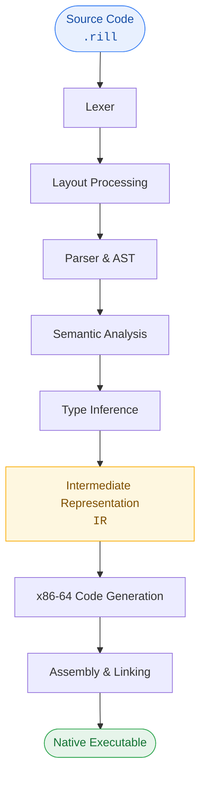

# Rill


Rill is an experimental programming language written in C++20. 
## Language

This language uses a concise syntax built around functions, patterns, and verbs.

### Functions

Functions are defined using `::` and `=>`:

```rill
double :: x => x + x
```

Multiple clauses can be used to define functions through pattern matching:

```rill
fib :: 0 => 0
    :: 1 => 1
    :: n => fib (n - 1) + fib (n - 2)
```

### Pattern Matching

Expressions can be matched against patterns using `?|`:

```rill
value ?| 0 => "zero"
      | n => n
```

### Lists and Ranges

Lists use square brackets:

```rill
[1, 2, 3]
```

Range expressions are also supported:

```rill
[1..10]
[1, 3..]
```


### Additional Constructs

The language includes several experimental constructs:

- `orbit`
- `isomorph`
- `lattice`
- `manifold`

These are part of Rill's ongoing exploration of alternative programming abstractions.

## Compiler

Rill is implemented as a compiler written in C++20.

The compilation pipeline consists of:

## Compilation Pipeline

Rill compiles `.rill` source files into native x86-64 executables through a series of compiler stages.




## Development Status

Dead.

## Contributing

Contributions, bug reports, and language-design discussions are not welcomed.
